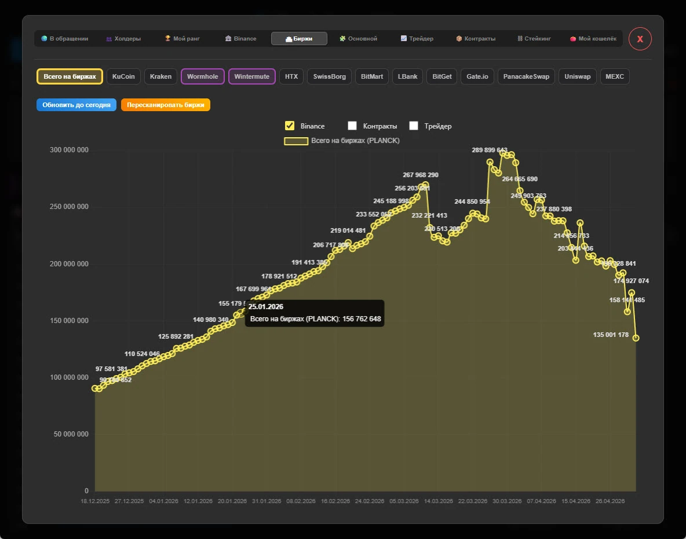

# Planck Scan - аналитика держателей токена

Автор проекта - **Евгений Толмачев**. [Профиль GitHub](https://github.com/EvgenyET) · [Проект в портфолио](https://evgeny-dev.pro/project.html?id=Planck_scan)

Настольный инструмент для анализа держателей PLANCK. Собирает кошельки и контракты, показывает доли предложения, позиции в рейтинге и изменение балансов во времени.

## Задача проекта

Проект вырос из скрипта получения держателей в настольное аналитическое приложение. Задача разработки - связать длительное сканирование внешних источников, локальную историю и интерактивные графики. Это потребовало обработки постраничной выдачи, ошибок RPC и разной полноты исторических данных.

## Мой вклад

Разработал сборщик держателей и перенёс его в Electron-приложение. Реализовал разделение кошельков и контрактов, расчёт долей и рейтингов, отслеживание выбранных адресов. Добавил повторные запросы, переключение RPC, сохранение снимков и восстановление истории по событиям Transfer. Связал результаты с таблицами и графиками Chart.js.

## Интерфейс

**Сводка и список держателей PLANCK**

**График изменения показателя по истории сканирований**

## Как работает приложение

Planck Scan помогает исследовать, как распределён токен PLANCK и как меняются позиции его держателей. Приложение собирает адреса через Moralis, проверяет тип адреса через RPC и строит таблицу с балансами и долями предложения. Пользователь может выделить отдельный кошелёк или группу биржевых адресов и проследить изменения на графике. Сохранённые снимки и история переводов позволяют возвращаться к предыдущим состояниям.

## Возможности

- Постраничный сбор держателей с отображением прогресса, повторными запросами и переключением RPC-узлов при сбоях.
- Классификация адресов, расчёт балансов, доли предложения и положения отслеживаемого кошелька в рейтинге.
- Отдельные графики контрактов, биржевых адресов и выбранных кошельков.
- Сохранение результатов и временных срезов в локальные файлы для сравнения изменений.
- Восстановление истории выбранных адресов по переводам токена и просмотр связанных ончейн-метрик.

## Техническое устройство

### Получение и обработка данных

Основной процесс Electron получает страницы держателей из Moralis и проверяет адреса через ethers. Параллельная обработка ограничена, ошибки RPC обрабатываются повторными запросами и сменой узла.

### История сканирований

Результаты сканирования, балансы и история переводов сохраняются локально. Для восстановления временных рядов используются предыдущие снимки и события Transfer.

### Интерфейс и графики

Renderer управляет таблицами, переключателями групп адресов и графиками Chart.js. Preload передаёт команды сканирования и результаты между интерфейсом и основным процессом.

## Технологии

| Технология | Роль в проекте |
| --- | --- |
| Electron | Настольное окно, доступ к локальному хранилищу и обмен сообщениями между процессами. |
| JavaScript / Node.js | Логика сканирования, обработка результатов и сохранение истории. |
| ethers | Запросы к RPC: проверка кода адреса, чтение балансов и событий контракта. |
| Moralis API | Списки держателей, переводы и дополнительные данные о токене. |
| Chart.js | Временные ряды балансов, долей предложения и рейтингов. |

## Состояние показанной версии

- Для нового полного сканирования нужны доступный RPC и настроенный ключ Moralis.
- Полнота исторических графиков зависит от сохранённых снимков и доступности данных о переводах.

## Демонстрация

На странице портфолио доступны описание, галерея и видеодемонстрация проекта. [Открыть Planck Scan - аналитика держателей токена](https://evgeny-dev.pro/project.html?id=Planck_scan).
