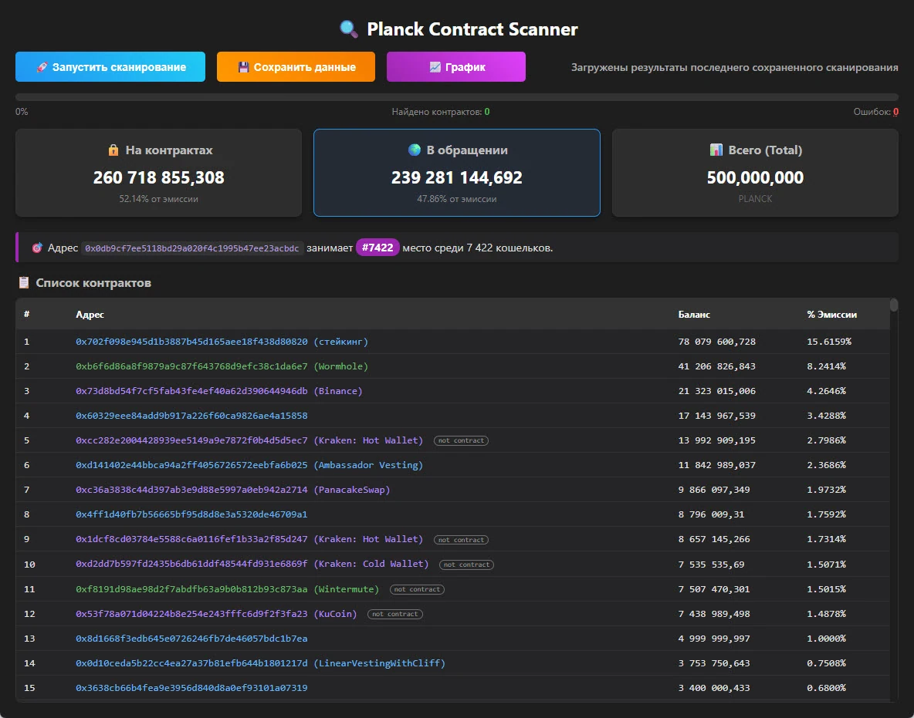

# Planck Scan - аналитика держателей токена

**Автор проекта:** [Евгений Толмачев](https://github.com/EvgenyET) · [Страница проекта в портфолио](https://evgeny-dev.pro/project.html?id=Planck_scan)

Настольный сканер держателей PLANCK: балансы кошельков и контрактов, распределение предложения, позиции в рейтинге и история изменений.

## Мой вклад

Начал с утилиты для сбора держателей PLANCK и перенёс работу со списком в настольное приложение. Разделил кошельки и контракты, добавил отслеживание отдельных адресов и историю снимков, чтобы изменения баланса можно было увидеть на графике.

## Интерфейс

**Сводка и список держателей PLANCK**

**График изменения показателя по истории сканирований**

## Как это работает

Приложение собирает владельцев токена через Moralis, проверяет адреса через RPC и разделяет обычные кошельки и смарт-контракты. В интерфейсе можно следить за выбранными адресами и биржевыми группами, сравнивать доли предложения и просматривать графики по сохранённой истории сканирований.

## Возможности

- Постраничный сбор держателей с отображением прогресса, повторными запросами и переключением RPC-узлов при сбоях.
- Классификация адресов, расчёт балансов, доли предложения и положения отслеживаемого кошелька в рейтинге.
- Отдельные графики контрактов, биржевых адресов и выбранных кошельков.
- Сохранение результатов и временных срезов в локальные файлы для сравнения изменений.
- Восстановление истории выбранных адресов по переводам токена и просмотр связанных ончейн-метрик.

## Технологии

JavaScript, Electron, Node.js, ethers, Moralis API, Chart.js.
